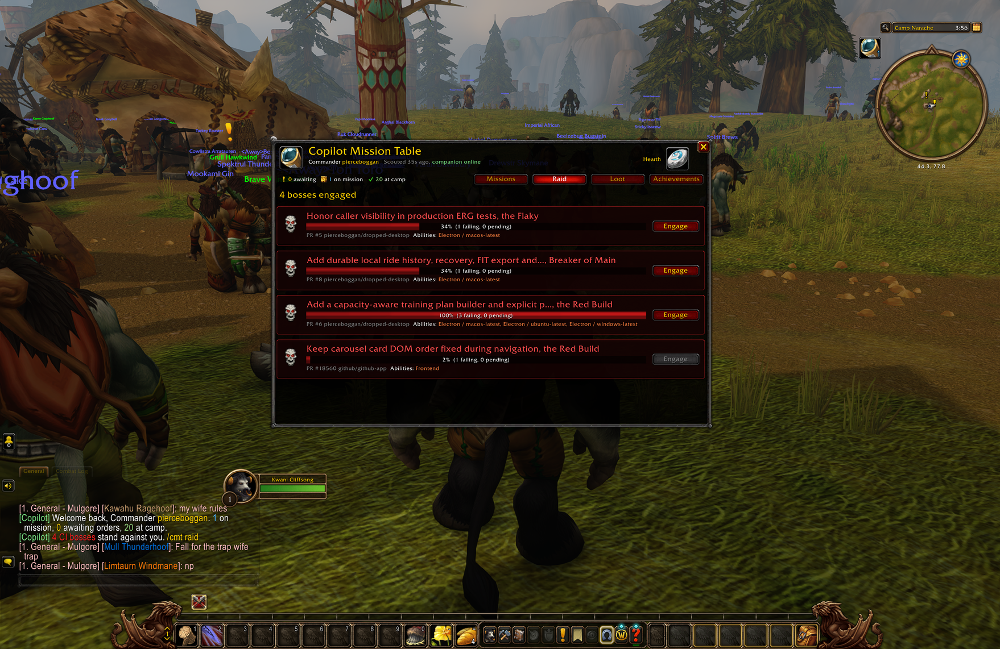
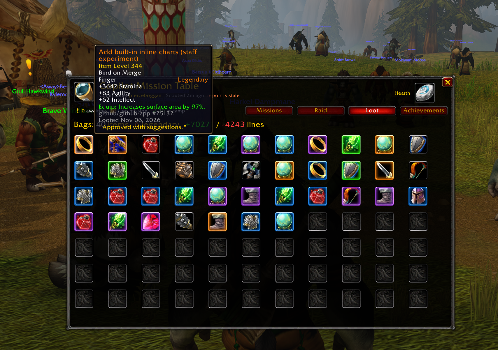
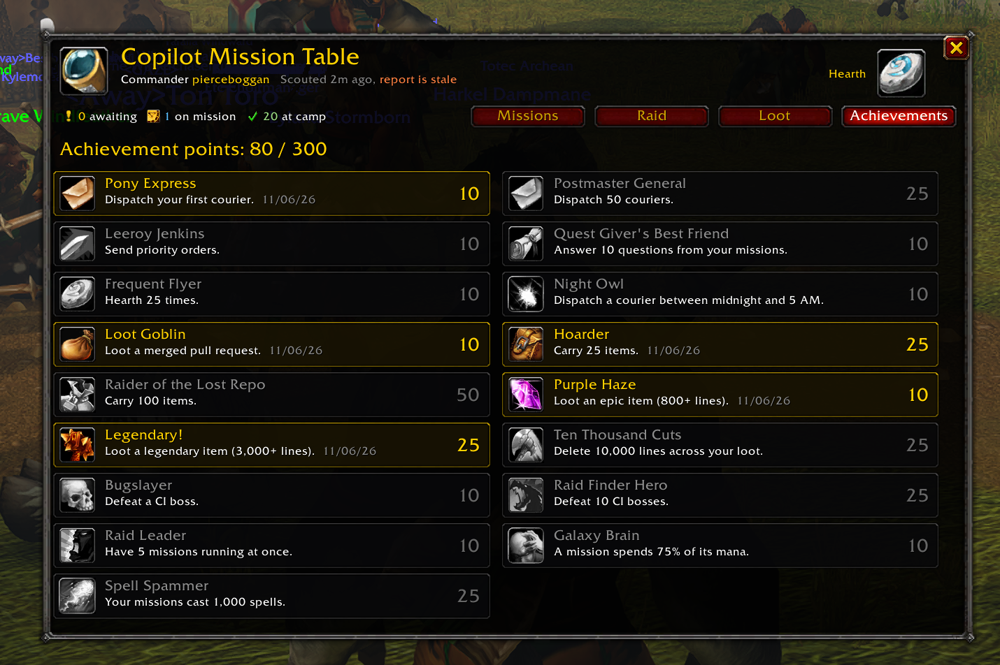

# Copilot Mission Table

Command your GitHub Copilot app sessions from a garrison table inside World of Warcraft.

Every session joins your roster as a follower out on a mission. A busy one casts "Thinking..." on loop until the cast bar fills. When a session needs you, a yellow "!" floats over its head and a raid warning hits your screen, and its `ask_user` choices show up as gossip options you can click like any innkeeper's dialogue. Context use drains a blue mana bar. You write orders, hand them to a courier, and Hearth home (`/reload`) to send him running.



## How the courier gets there

Blizzard keeps addons in a sealed room with no network and no file access while the game runs. So a small companion process on your Mac carries messages through the wall:

```
Copilot app --ws (observer)--> companion --writes--> AddOns/CopilotMissionTable/Inbox.lua --/reload--> addon
addon --/reload--> WTF/.../SavedVariables/CopilotMissionTable.lua --watched--> companion --send_message--> Copilot app
```

Each `/reload` makes WoW save your queued orders to disk and pull in the latest scouting report. Within a second or two the companion picks up your orders and delivers them, and your next Hearth confirms they landed. It all stays inside Blizzard's addon rules. Nothing automates input, and nothing reads game memory.

## Attunement

You need Node 22+ and the GitHub Copilot app running.

```sh
node companion/companion.mjs install --wow "/Applications/World of Warcraft"   # once; remembers the path
node companion/companion.mjs                                                   # leave running while you play
```

Retail is the default. For Classic, add `--flavor _classic_` or `--flavor _classic_era_` to the install line. WoW Forever lives in the `_forever_` folder and wants `--flavor _forever_`. Restart WoW once after installing so the addon list picks up the new arrival.

On Forever (client 1.60.1, where this addon was field tested) the AddOns screen marks Mission Table as Incompatible, since the TOC doesn't list Interface 16001 yet. Tick "Load out of date AddOns" and it loads fine.

## Your spellbook

| | |
|---|---|
| Beacon (draggable spyglass) | Count of missions needing you; click to open |
| `/cmt` or `/copilot` | Open the Mission Table |
| `/cmt list` | Roll call with numbers |
| `/cmt 3 run the tests again` | Queue orders for mission 3 |
| `/cmt 3! stop and summarize` | Priority orders (read at the next turn) |
| `/cmt answer 3 2` | Answer mission 3's question with choice 2 (or free text) |
| `/cmt sync` or the Hearth button | `/reload`: dispatch couriers and fetch reports |
| `/cmt raid` | CI bosses: open PRs with failing checks. **Engage** drafts fix-it orders to the mission on that branch |
| `/cmt loot` | Your bags: every merged PR is an item, with quality set by lines changed |
| `/cmt ach` | Achievements |
| `/cmt log` | Combat log: your missions' tool calls as spells ("Detect Magic hits \"TODO\" for 812") |
| `/cmt sound`, `/cmt announce` | Toggle alerts |

Loot drops and boss spawns come from `gh api graphql` every 3 minutes, so sign in to `gh` before you pull.

Merge a big enough PR and it drops as a Legendary ring, Bind on Merge, with the review comment as flavor text.



The Achievements tab tracks the long grind. Leeroy Jenkins goes to anyone who sends priority orders. Night Owl wants a courier dispatched between midnight and 5 AM.



## Known debuffs

- Updates arrive on `/reload`. Live in-game updates would mean breaking out of WoW's sandbox, which isn't possible.
- Permission prompts have to be answered in the app. The addon flags them so you know to alt-tab.
- If the companion was offline when a session asked a question, that question is gone for good, because the app doesn't persist them.
- After you steer a session from WoW, the app routes that session's UI tool actions (opening canvases, for example) to the companion. That lasts until you next send from the app window.
- The companion talks to the app over its local WebSocket (`~/.copilot/run/ws.*`). That's an internal protocol, and an app update can change it.

## For tinkerers

```sh
node companion/companion.mjs status        # print what the addon would see
lua tools/smoke.lua path/to/Inbox.lua      # run the addon headless against stubbed WoW APIs
```
